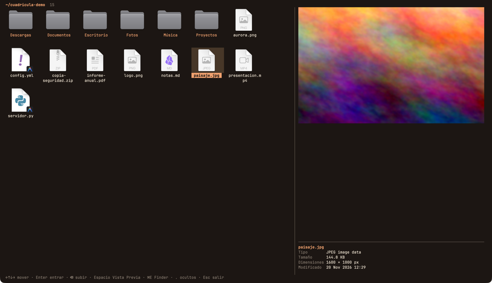
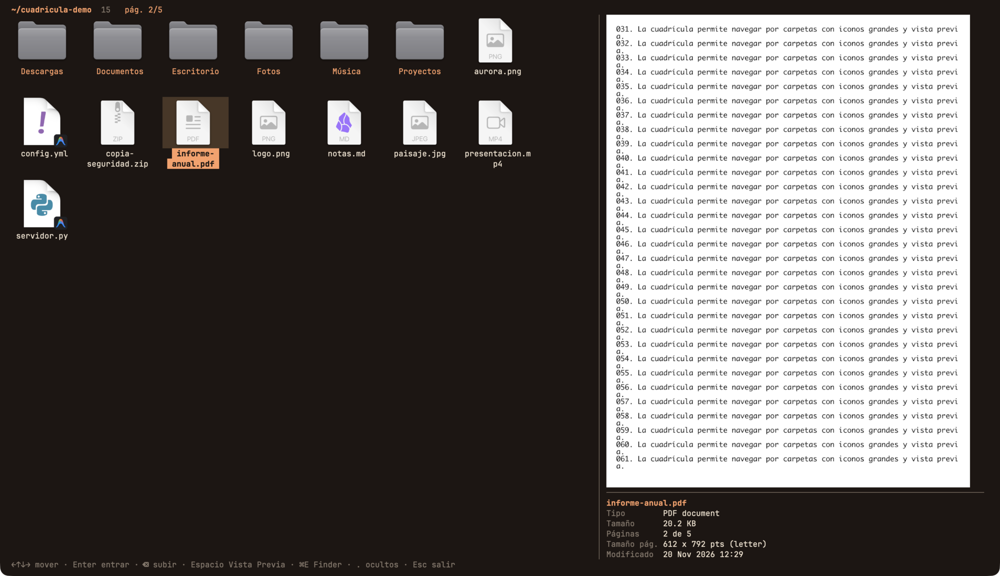
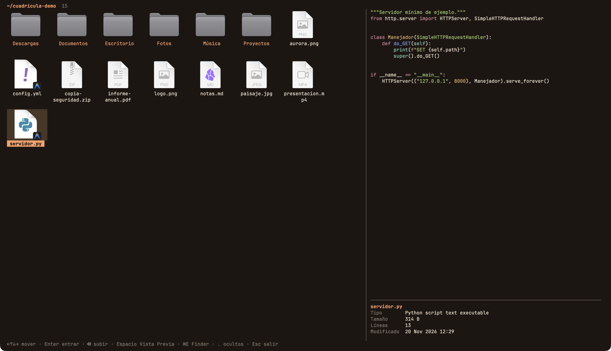
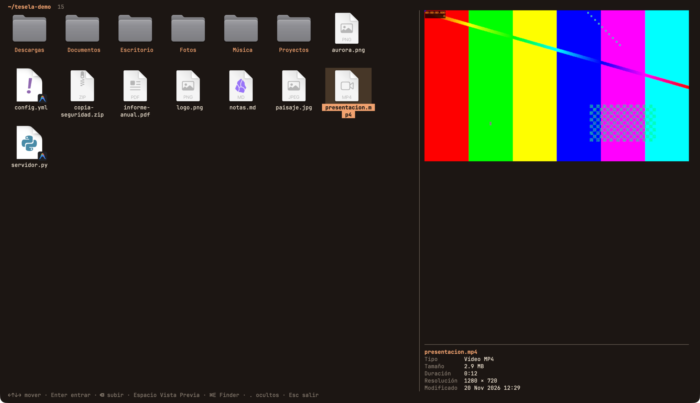
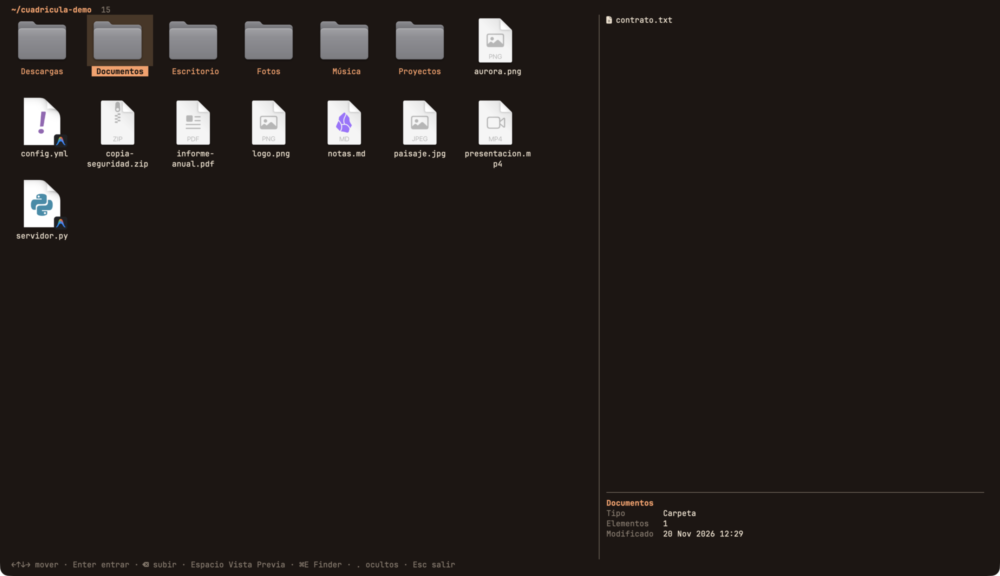

<div align="center">

[Español](README.md) · **English**

# tesela

**A terminal folder browser with Finder-style icon tiles and a real preview of whatever you have selected.**




</div>

---

## What is it?

`tesela` (launched with `g`) is a file manager that lives in the terminal but **looks and moves like the Finder's icon view**:

- on the **left**, the folder as a grid of tiles with the **real macOS icons**;
- on the **right**, a **preview** of the selection with its **details** underneath;
- you move with the **arrow keys** in two dimensions, and when you quit **your shell stays in that folder**, like a `cd`.

It is a single Python file with no pip dependencies. *(Note: it's a file manager, not a window manager.)*

## Features

- 🗂️ **Large tiles**: icon on top, name below (one or two lines, keeping the extension when it is long).
- 🖼️ **System icons** (folders with their emblem, PDF, PNG, Python…) requested from macOS in batches and shared between identical files.
- 👁️ **Real pixel previews** through the kitty graphics protocol: images, PDF, video, SVG and HEIC.
- 📄 **Paged PDFs**: the mouse wheel changes page, and neighbouring pages are prefetched so switching feels smooth.
- 💻 **Syntax-highlighted code and text** with wheel scrolling.
- ℹ️ **Details** under the preview: type, size, dimensions, pages, duration, lines, date.
- ⚡ **Always responsive**: previews and icons are computed on background threads; nothing freezes the UI (not even a 12-megapixel HEIC).
- 🔄 **Live refresh** when the folder changes from outside.
- ⌨️ **`Cmd+E`** opens the current folder in Finder, **`Space`** opens with Preview, **`Enter`** enters folders.

## Gallery

<table>
  <tr>
    <td align="center"><b>PDF: the wheel changes page</b><br></td>
    <td align="center"><b>Syntax-highlighted code</b><br></td>
  </tr>
  <tr>
    <td align="center"><b>Video: thumbnail, duration and resolution</b><br></td>
    <td align="center"><b>Folders: contents on the right</b><br></td>
  </tr>
</table>

## Requirements

| | What | Why |
|---|---|---|
| **Required** | macOS, `python3` | Icons come from `NSWorkspace`, image conversion from `sips` |
| **Required** | [`eza`](https://github.com/eza-community/eza) | File listing, ordering, fallback glyphs and colours |
| **Terminal** | [Ghostty](https://ghostty.org) (tested) | Kitty graphics protocol to show real images |
| Optional | `bat` | Highlighted code and text |
| Optional | `poppler` (`pdftoppm`, `pdfinfo`) | PDF |
| Optional | `ffmpegthumbnailer`, `ffmpeg` | Video thumbnails and metadata |
| Optional | `imagemagick` | Large or uncommon images |
| Optional | `resvg` | SVG |
| Optional | `chafa` | Images in terminals without a graphics protocol |

```sh
brew install eza bat poppler ffmpegthumbnailer ffmpeg imagemagick resvg chafa
```

## Install

```sh
git clone https://github.com/Cosmichomeless/tesela.git
cd tesela
./install.sh --zshrc
```

The installer copies the script to `~/.local/bin`, tells you which dependencies are missing and, with `--zshrc`, adds the `g` function to your `~/.zshrc` (it won't touch it if it already exists). Then open a new tab and run:

```sh
g              # current folder
g ~/Documents  # another folder
```

### Recommended in Ghostty

By default Ghostty reserves `Cmd+E` ("use selection for find"), so it never reaches the program. Free it in `~/.config/ghostty/config`:

```
keybind = cmd+e=unbind
```

### Colour theme (optional)

[`examples/eza-theme.yml`](examples/eza-theme.yml) is the warm palette seen in the screenshots. Copy it to `~/.config/eza/theme.yml` and export `EZA_CONFIG_DIR="$HOME/.config/eza"` (on macOS eza does not look there by default; the `~/.zshrc` snippet already does it).

## Usage

| Key | Action |
|---|---|
| `←` `→` | Previous / next tile |
| `↑` `↓` | One row up / down |
| `Enter` | Enter the folder, or open the file with its app |
| `Backspace` | Go to the parent folder (with the folder you came from selected) |
| `Space` | Open the file with Preview |
| `Cmd` + `E` | Reveal in Finder (folder: opens it; file: selects it) |
| `.` | Show or hide hidden files |
| **Mouse wheel** | PDF: change page · text and code: scroll |
| `Esc` · `q` · `Ctrl+C` | Quit (the shell stays in the last folder) |

> **Note:** because the tool captures the mouse for the wheel, hold `Shift` to select text with the mouse.

### Command line

```
tesela [folder] [--cwd-file=PATH] [--sel=N] [--page=N] [--dump=WIDTHxHEIGHT]
tesela --help | --version
```

| Option | What it does |
|---|---|
| `folder` | Starting folder (defaults to the current one) |
| `--cwd-file=PATH` | On exit, writes the final folder there; the `g` function uses it to `cd` |
| `--sel=N` | Start with item number `N` selected (handy for screenshots and demos) |
| `--page=N` | Start at page (or line) `N` of the preview |
| `--dump=WIDTHxHEIGHT` | Print one text frame and exit, without opening the UI (handy for tests) |

## Customisation

Everything lives in one file; the knobs are a few constants at the top of `tesela`:

| Constant | Value | What it changes |
|---|---|---|
| `ICON_ROWS` | `5` | Icon height in terminal rows. Raise it for bigger icons |
| `TILE_W` | `16` | Tile width in columns |
| `MIN_WIDE` | `64` | Below this window width the preview is hidden |
| `DET_H` | `7` | Rows of the details block |
| `SEL_BG`, `TEXT` | RGB colours | Selected tile background and name colour |

The split between grid and preview (60 % / 40 %) is in the `panes()` function.

## How it works

- **Listing:** comes from `eza` (ordering, folders first, colours and fallback glyphs).
- **Icons:** a JXA script calls `NSWorkspace.iconForFile` and returns 256 px PNGs. They are requested in batches, only the visible tiles plus two rows ahead; identical ones (all plain folders) share one image.
- **Images:** every PNG is **transmitted once** to the terminal (`a=t`) and afterwards only **placed** (`a=p`) where needed, so redraws never resend data. Every command carries `q=2` so the terminal does not reply and pollute the input.
- **Preview by type:**

  | Type | How |
  |---|---|
  | Code and text | `bat --theme=ansi` (or plain read) |
  | Folder | `eza` on the folder |
  | Image | `sips` / `magick` → PNG → real image |
  | PDF | `pdftoppm` at 150 dpi, one page at a time, neighbours prefetched |
  | Video | `ffmpegthumbnailer` |
  | SVG / HEIC | `resvg` / `sips` |
  | Others | type, size and date |

- **Smoothness:** heavy work runs on background threads and the UI keeps responding; while a new PDF page loads, the previous one stays on screen.

## Compatibility

| Terminal | Result |
|---|---|
| **Ghostty** | Everything: real icons, pixel previews, wheel. **This is where it is tested.** |
| Kitty, WezTerm | Same graphics protocol, should work, untested |
| Others (Terminal.app, iTerm2…) | Text-glyph tiles instead of icons; images are drawn with colour blocks if you have `chafa` |

macOS only for now: it depends on `NSWorkspace` and `sips`. You need a [Nerd Font](https://www.nerdfonts.com/) for the fallback glyphs.

## Try it with sample files

```sh
scripts/make-demo.sh        # creates ~/tesela-demo with images, a PDF, a video, code…
g ~/tesela-demo
```

The screenshots in this README were taken with that folder.

## FAQ

**Is it a window manager?** No, it is a file manager. It browses folders; it does not move windows.

**Why not yazi, ranger or lf?** They are excellent (yazi is in fact the inspiration for the preview), but none offers a Finder-style icon-tile view. `tesela` does one thing: that view, with preview and details.

**Does it delete or modify files?** No. It is read-only: it lists, previews and opens; it never writes to your folders.

**Can I change the icon size?** Yes, with `ICON_ROWS` and `TILE_W`.

## Status

Version **0.1.0** (beta). Works well for the author's daily use but it is young: if something breaks, [open an issue](../../issues/new/choose).

## Contributing

Ideas and PRs are welcome; read [CONTRIBUTING.md](CONTRIBUTING.md). Smoke tests run with `bash tests/smoke.sh`.

## Roadmap

- [ ] Create, rename and delete folders and files from within the tool
- [ ] Tile size adjustable with keys
- [ ] Linux version (icons from the system theme)
- [ ] Search by name

## License

[MIT](LICENSE)
