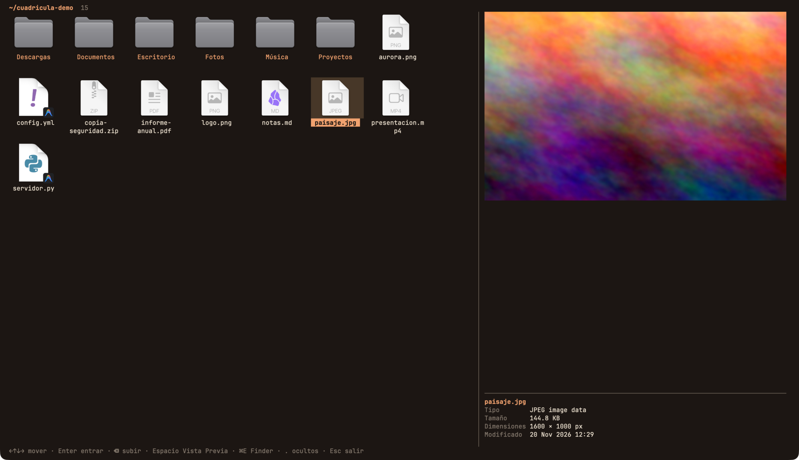
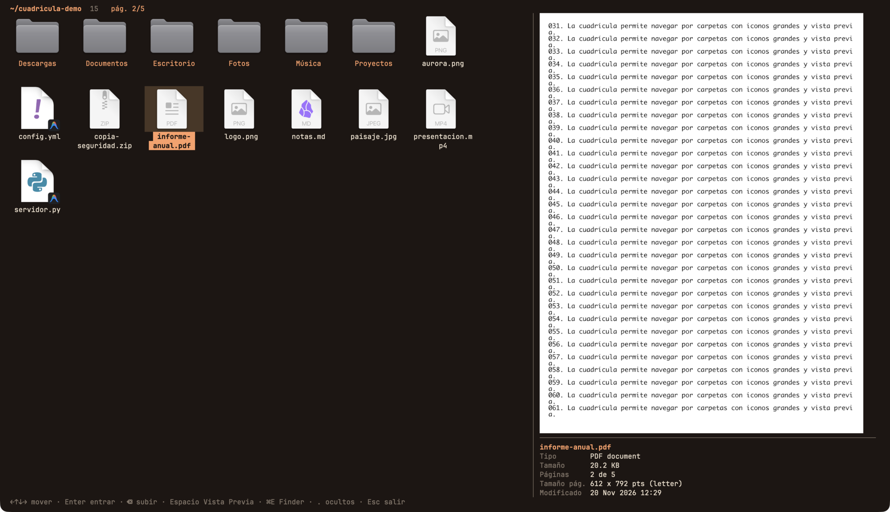
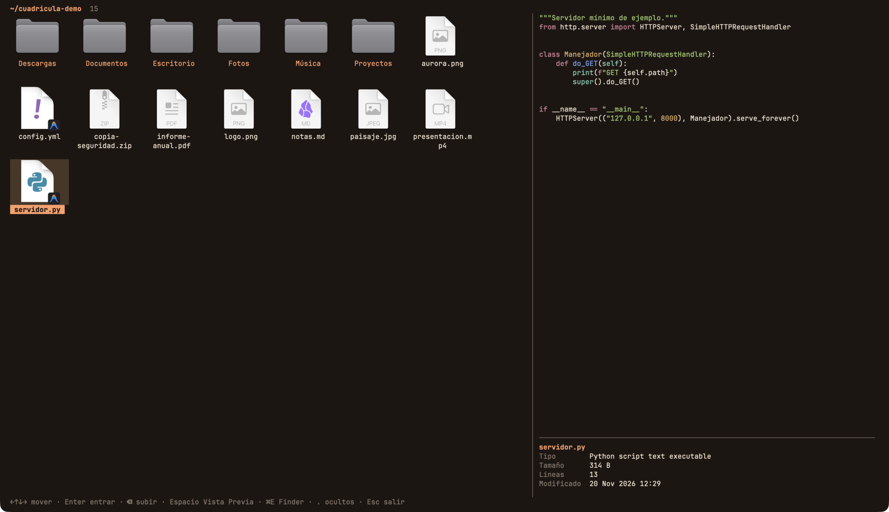
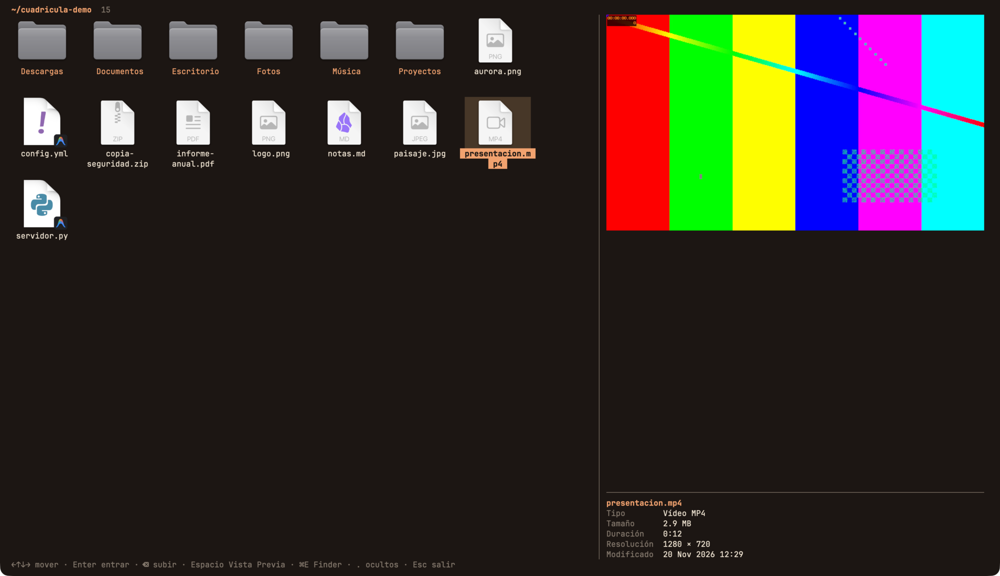
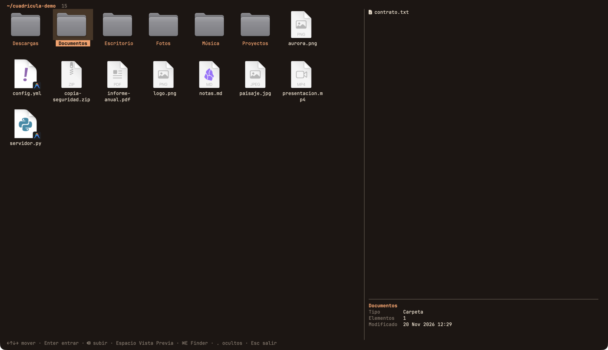

<div align="center">

# cuadricula

**Un navegador de carpetas para la terminal, con mosaicos de iconos como el Finder y vista previa real de lo que tienes seleccionado.**




</div>

---

## ¿Qué es?

`cuadricula` (se lanza con `g`) es un explorador de ficheros que vive en la terminal pero **se ve y se mueve como el Finder en vista de iconos**:

- a la **izquierda**, la carpeta como una cuadrícula de mosaicos con los **iconos reales de macOS**;
- a la **derecha**, la **vista previa** de lo seleccionado y debajo sus **detalles**;
- te mueves con las **flechas** en dos dimensiones y, al salir, **tu shell se queda en esa carpeta**, como un `cd`.

Es un único fichero de Python, sin dependencias de pip.

## Características

- 🗂️ **Mosaicos grandes** con icono arriba y nombre debajo (en una o dos líneas, conservando la extensión si es largo).
- 🖼️ **Iconos del sistema** (carpetas con su emblema, PDF, PNG, Python…) pedidos a macOS por lotes y compartidos entre ficheros iguales.
- 👁️ **Vista previa real, con píxeles** gracias al protocolo gráfico de kitty: imágenes, PDF, vídeo, SVG y HEIC.
- 📄 **PDF paginado**: la rueda del ratón cambia de página, y las páginas vecinas se precargan para que el cambio sea fluido.
- 💻 **Código y texto con color** y desplazamiento con la rueda.
- ℹ️ **Detalles** bajo la vista previa: tipo, tamaño, dimensiones, páginas, duración, líneas, fecha.
- ⚡ **Siempre responde**: las vistas previas y los iconos se calculan en hilos aparte; nada congela la pantalla (ni siquiera un HEIC de 12 megapíxeles).
- 🔄 **Se actualiza solo** cuando la carpeta cambia desde fuera.
- ⌨️ **`Cmd+E`** abre en el Finder, **`Espacio`** abre con Vista Previa, **`Enter`** entra en carpetas.

## Galería

<table>
  <tr>
    <td align="center"><b>PDF, página 2 de 5</b><br></td>
    <td align="center"><b>Código con color</b><br></td>
  </tr>
  <tr>
    <td align="center"><b>Vídeo: miniatura, duración y resolución</b><br></td>
    <td align="center"><b>Carpetas: su contenido a la derecha</b><br></td>
  </tr>
</table>

## Requisitos

| | Qué | Para qué |
|---|---|---|
| **Obligatorio** | macOS, `python3` | Los iconos salen de `NSWorkspace` y la conversión de imágenes de `sips` |
| **Obligatorio** | [`eza`](https://github.com/eza-community/eza) | Lista de ficheros, orden, iconos de texto y colores |
| **Terminal** | [Ghostty](https://ghostty.org) o [Kitty](https://sw.kovidgoyal.net/kitty/) | Protocolo gráfico para mostrar imágenes de verdad |
| Opcional | `bat` | Código y texto con colores |
| Opcional | `poppler` (`pdftoppm`, `pdfinfo`) | PDF |
| Opcional | `ffmpegthumbnailer`, `ffmpeg` | Miniaturas y datos de vídeo |
| Opcional | `imagemagick` | Imágenes grandes o poco comunes |
| Opcional | `resvg` | SVG |
| Opcional | `chafa` | Imágenes en terminales sin protocolo gráfico |

```sh
brew install eza bat poppler ffmpegthumbnailer ffmpeg imagemagick resvg chafa
```

## Instalación

```sh
git clone <url-del-repositorio> cuadricula
cd cuadricula
./install.sh --zshrc
```

El instalador copia el script a `~/.local/bin`, te dice qué dependencias faltan y, con `--zshrc`, añade la función `g` a tu `~/.zshrc` (si ya existe, no la toca). Después abre otra pestaña y escribe:

```sh
g              # la carpeta actual
g ~/Documents  # otra carpeta
```

### Recomendado en Ghostty

Por defecto Ghostty reserva `Cmd+E` ("usar la selección para buscar") y no le llega al programa. Libéralo en `~/.config/ghostty/config`:

```
keybind = cmd+e=unbind
```

### Tema de colores (opcional)

[`examples/eza-theme.yml`](examples/eza-theme.yml) es la paleta cálida que se ve en las capturas. Cópiala a `~/.config/eza/theme.yml` y exporta `EZA_CONFIG_DIR="$HOME/.config/eza"` (en macOS eza no mira esa ruta por defecto; el instalador ya lo hace en el fragmento de `~/.zshrc`).

## Uso

| Tecla | Acción |
|---|---|
| `←` `→` | Mosaico anterior / siguiente |
| `↑` `↓` | Una fila arriba / abajo |
| `Enter` | Entrar en la carpeta, o abrir el fichero con su aplicación |
| `Retroceso` | Subir a la carpeta padre (con la carpeta de la que vienes seleccionada) |
| `Espacio` | Abrir el fichero con Vista Previa |
| `Cmd` + `E` | Mostrar en el Finder (carpeta: la abre; fichero: lo selecciona) |
| `.` | Mostrar u ocultar los ficheros ocultos |
| **Rueda del ratón** | PDF: cambiar de página · texto y código: desplazar |
| `Esc` · `q` · `Ctrl+C` | Salir (la shell se queda en la última carpeta) |

> **Nota:** como la herramienta usa el ratón para la rueda, para seleccionar texto con el ratón tienes que mantener `Shift`.

### Opciones de línea de comandos

```
cuadricula [carpeta] [--cwd-file=RUTA] [--sel=N] [--page=N] [--dump=ANCHOxALTO]
```

| Opción | Qué hace |
|---|---|
| `carpeta` | Carpeta inicial (por defecto la actual) |
| `--cwd-file=RUTA` | Al salir escribe ahí la carpeta final; es lo que usa la función `g` para hacer el `cd` |
| `--sel=N` | Empieza con el elemento número `N` seleccionado (útil para capturas y demos) |
| `--page=N` | Empieza en la página (o línea) `N` de la vista previa |
| `--dump=ANCHOxALTO` | Imprime un fotograma de texto y sale, sin abrir la interfaz (útil para pruebas) |

## Personalización

Todo está en un solo fichero y lo importante son unas pocas constantes al principio de `cuadricula`:

| Constante | Valor | Qué cambia |
|---|---|---|
| `ICON_ROWS` | `5` | Alto del icono en filas de terminal. Súbelo para iconos más grandes |
| `TILE_W` | `16` | Ancho de cada mosaico en columnas |
| `MIN_WIDE` | `64` | Por debajo de este ancho de ventana se oculta la vista previa |
| `DET_H` | `7` | Filas del bloque de detalles |
| `SEL_BG`, `TEXT` | colores RGB | Fondo del seleccionado y color de los nombres |

El reparto entre cuadrícula y vista previa (60 % / 40 %) está en la función `panes()`.

## Cómo funciona

```
              ┌──────────────────────────── cuadricula (Python) ────────────────────────────┐
  eza  ────►  │ lista, orden y glifos          hilo de iconos ◄── osascript + NSWorkspace   │
              │                                hilo de vistas previas                       │
  teclado ──► │ bucle principal ──► un fotograma de texto + órdenes del protocolo gráfico   │ ──► Ghostty
  ratón       └─────────────────────────────────────────────────────────────────────────────┘
```

- **Lista:** se obtiene de `eza` (orden, carpetas primero, colores y glifos de reserva).
- **Iconos:** un script JXA llama a `NSWorkspace.iconForFile` y devuelve PNG de 256 px. Se piden por lotes y solo los visibles más dos filas; los idénticos (todas las carpetas normales) comparten imagen.
- **Imágenes:** cada PNG se **transmite una sola vez** a la terminal (`a=t`) y después solo se **coloca** (`a=p`) donde haga falta, sin reenviar datos al redibujar. Todas las órdenes llevan `q=2` para que la terminal no conteste y ensucie la entrada.
- **Vista previa por tipo:**

  | Tipo | Cómo se genera |
  |---|---|
  | Código y texto | `bat --theme=ansi` (o lectura directa) |
  | Carpeta | `eza` sobre la carpeta |
  | Imagen | `sips` / `magick` → PNG → imagen real |
  | PDF | `pdftoppm` a 150 ppp, una página cada vez, con precarga de las vecinas |
  | Vídeo | `ffmpegthumbnailer` |
  | SVG / HEIC | `resvg` / `sips` |
  | Otros | tipo, tamaño y fecha |

- **Fluidez:** los cálculos pesados van a hilos aparte y la interfaz sigue respondiendo; mientras llega una nueva página del PDF se mantiene la anterior en pantalla.

## Compatibilidad

| Terminal | Resultado |
|---|---|
| Ghostty, Kitty | Todo: iconos reales, vistas previas con píxeles, rueda |
| Otras | Mosaicos con glifo de texto en lugar de icono; las imágenes se dibujan con bloques de color si tienes `chafa` |

Solo macOS por ahora: depende de `NSWorkspace` y `sips`.

## Probarlo con ficheros de ejemplo

```sh
scripts/make-demo.sh        # crea ~/cuadricula-demo con imágenes, un PDF, un vídeo, código…
g ~/cuadricula-demo
```

Las capturas de este README están hechas con esa carpeta.

## Hoja de ruta

- [ ] Crear, renombrar y borrar carpetas y ficheros desde la propia herramienta
- [ ] Tamaño de mosaico ajustable con teclas
- [ ] Versión para Linux (iconos del tema del sistema)
- [ ] Búsqueda por nombre

## Licencia

[MIT](LICENSE)
